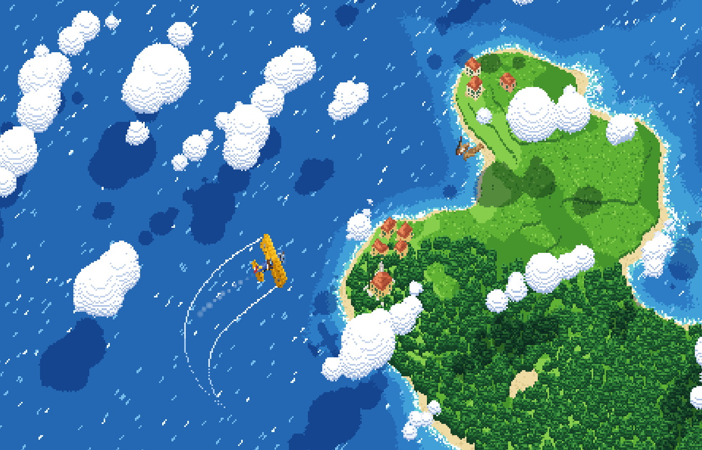
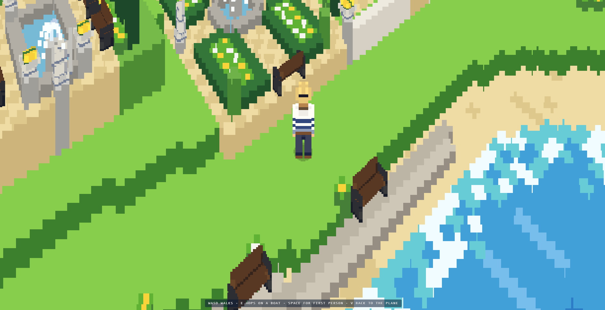
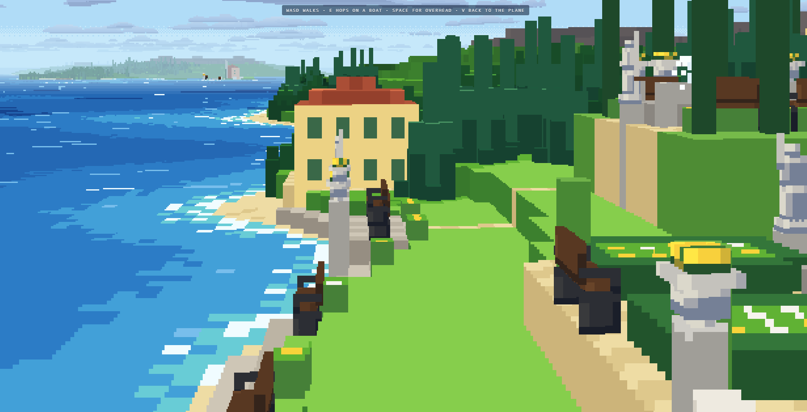
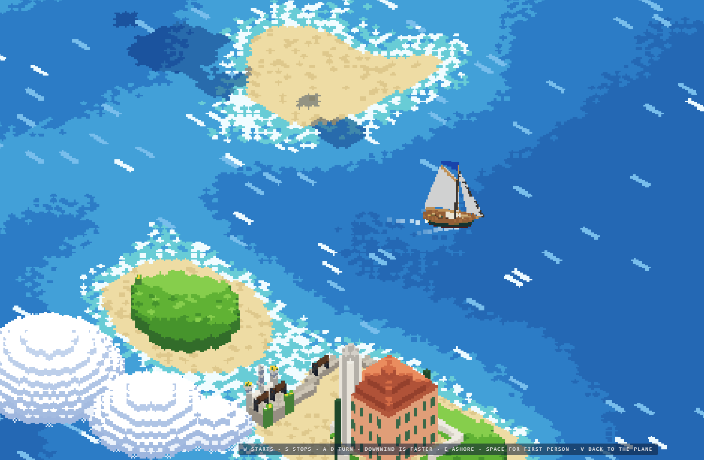
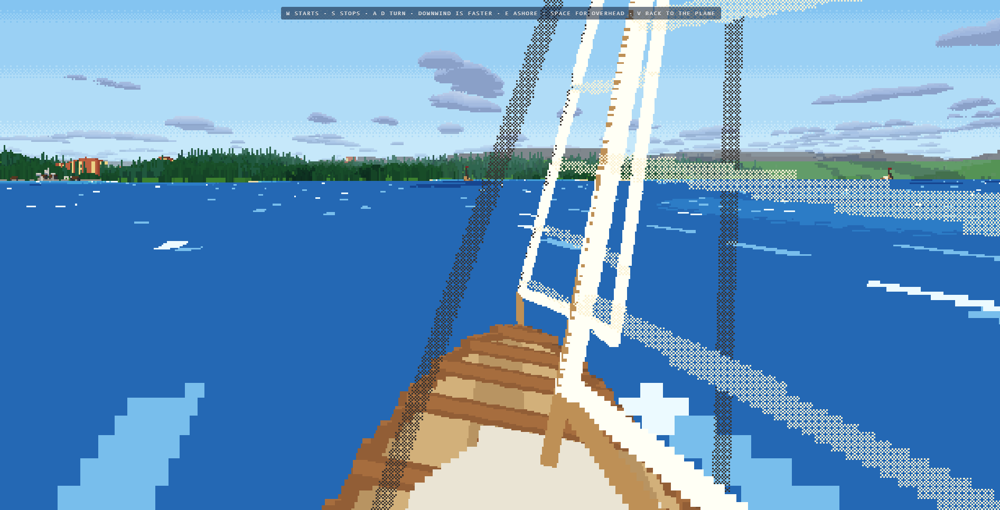

# enzo_voxel



**Enzo's day** is a pixel-art flying game. You fly a 1920s biplane over Lake Como–style islands with villas, forests, docks, classic yachts, fish and whales. You can land as a man in a boater hat, walk around, and take a sailboat out. Among the villas stand a domed chapel in a walled Italian garden and a flint garden temple at the edge of a wood, and no bomb can bring them down. Press N and the light fades to night: villa windows, garden lamps and the boats' lights come on one by one.

Everything is drawn by a small software renderer in the browser, with no 3D engine. The ground and clouds are drawn on the graphics card (WebGL2) when the browser allows it, and on the CPU otherwise.

## Screenshots

| On foot | |
| --- | --- |
|  |  |
| Overhead | First person |

| In a boat | |
| --- | --- |
|  |  |
| Isometric | First person |

## Run

```
npm install
npm run dev
```

To draw everything on the CPU instead, add `?cpu` to the address, for example `http://localhost:5173/?cpu`.

## Play

| Key | Flying | On foot | In a boat |
| --- | --- | --- | --- |
| W / S | Dive / climb | Walk | Sail / stop |
| A / D | Turn | Turn | Turn |
| Shift or hold click | Throttle and smoke | | |
| Click | Barrel roll | | |
| B | Drop bombs | | |
| V | Become the man | Back to the plane | Back to the plane |
| E | | Board the nearest boat | Step ashore |
| Space | Overhead, chase, cockpit | Overhead or first person | Isometric or first person |
| N | Night or day | Night or day | Night or day |

On a phone there are buttons: View, Boost and Bomb, and Walk to go on foot. Flying, drag the way you want the plane to go, and tap to roll. On foot, drag anywhere to walk, Board appears when a boat is near, and Fly takes you back to the plane. In a boat, a tap sets sail or stops, and a drag points the boat the way you drag.

The game starts in the light of your clock, day from 7 am and night from 8 pm, and follows it until you press N.

How it all works is in [GAME.md](GAME.md).
